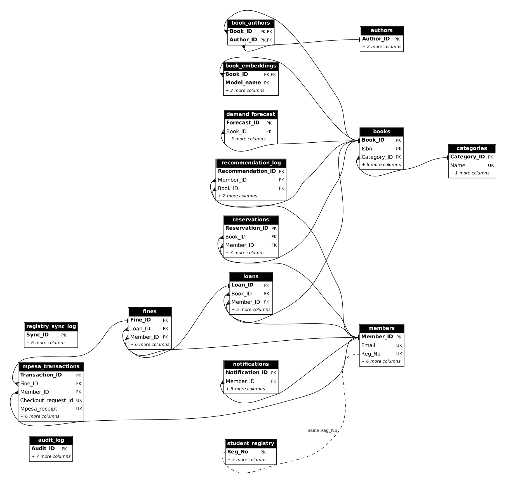

# Kisii University Library API

Semester project for **COMP 330 (API Design)** at Kisii University.

A REST API for the university library. Students and staff can search the catalog, borrow, reserve, renew and return books, and pay fines. Librarians can manage books, members, fines and notifications.

**Author:** Mkonzo Shirlean

---

## Table of contents

1. [Project overview](#1-project-overview)
2. [Repository structure](#2-repository-structure)
3. [Quick start](#3-quick-start)
4. [API design](#4-api-design)
5. [Data models](#5-data-models)
6. [Database](#6-database)
7. [Sample (seed) data](#7-sample-seed-data)
8. [Authentication and security](#8-authentication-and-security)
9. [Errors and pagination](#9-errors-and-pagination)
10. [External integrations and AI features](#10-external-integrations-and-ai-features)
11. [Testing](#11-testing)
12. [Documentation and mock server](#12-documentation-and-mock-server)
13. [Deployment](#13-deployment)
14. [Project timeline and status](#14-project-timeline-and-status)
15. [Tools](#15-tools)

---

## 1. Project overview

**Goal:** design a library API *design-first*. The API contract (an OpenAPI file) is written and agreed before any code, so the frontend, backend and database all build to the same document.

**Users**

| User | What they do |
|---|---|
| Student | Searches books, borrows, reserves, renews, returns and pays fines |
| Staff member | Does the same as a student |
| Librarian | Manages the catalog and members, issues fines, sends notifications |

**Resources:** Books, Members, Loans, Reservations, Fines, Categories, Authors and Notifications.

The OpenAPI file in `spec/` is the **single source of truth**. If this README and the spec ever disagree, the spec wins.

---

## 2. Repository structure

```
API_SEMESTER_PROJECT/
├── README.md
├── .github/workflows/
│   └── database-ci.yml           GitHub builds and checks the database on every push
├── docker-compose.yml            Runs the database in Docker
├── .env.example                  Names of the settings Docker needs (copy to .env)
├── docs/
│   ├── data-dictionary.md        Every table, column, view and trigger explained
│   ├── er-diagram.md             The ER diagram page, with the pictures
│   └── er-diagram*.png / .svg    The diagram as pictures (key columns, and all columns)
├── spec/
│   └── library-api.yaml          OpenAPI 3.0 specification
├── database/
│   ├── KISII_LIBRARY.sql         Full export of the database
│   ├── migrations/               Numbered changes 001 to 010 (the history of the database)
│   ├── backup/                   backup.sh and restore.sh
│   ├── SECURITY.md               Users, secrets, backups and recovery explained
│   ├── ci/                       check_database.sh: builds and checks a fresh database
│   ├── monitor/                  health_check.sh and enable_logging.sql
│   ├── MONITORING.md             Change log, alerts, health check and slow query log explained
│   ├── fix_schema.sql            One-time fixes (kept for reference, same as migration 002)
│   ├── seed.sql                  Sample data
│   ├── seed_extra.sql            Sample data for the newer tables
│   └── apply_new.sql             Runs migrations 004 to 007 and seed_extra.sql in one go
├── reports/
│   └── Week-01-Progress-Report.docx ... Week-15-Progress-Report.docx
└── evidence/
    └── Screenshots that show the work (mock server, tests, live API)
```

Add the `spec/` and `reports/` folders and the fix and seed files as you complete each part.

---

## 3. Quick start

You need MySQL installed.

**Option A: restore the full export**

```
mysql -u root -p -e "CREATE DATABASE KISII_LIBRARY CHARACTER SET utf8mb4;"
mysql -u root -p KISII_LIBRARY < database/KISII_LIBRARY.sql
```

The export does not create the database itself, which is why the first command comes first. If your export holds only the table structure, run `database/seed.sql` afterwards to add the sample data.

**Option B: build a brand-new database from the numbered files**

Run these in this order, each against an empty server:

```
mysql -u root -p < database/migrations/001_initial_schema.sql
mysql -u root -p < database/migrations/002_fix_schema.sql
mysql -u root -p < database/migrations/003_add_indexes.sql
mysql -u root -p < database/seed.sql
mysql -u root -p < database/migrations/004_student_registry.sql
mysql -u root -p < database/migrations/005_integrity_rules.sql
mysql -u root -p < database/migrations/006_ai_data_store.sql
mysql -u root -p < database/migrations/007_mpesa_and_sync.sql
mysql -u root -p < database/seed_extra.sql
```

Optionally, finish with `008_app_users.sql` to create the limited users (it needs passwords set first, so read the top of that file or `database/SECURITY.md`), and then `009_monitoring.sql` for the change log and health views (see `database/MONITORING.md`), followed straight away by `010_portable_table_sizes_view.sql`. Always run 009 **after** the sample data is loaded.

The result is identical to the export. Migrations 001 to 003 record the first version of the tables and the fixes that were applied to it, so **do not run 001 to 003 on a database that already has the tables**. Table and database names are not case sensitive on Windows, but they are on Linux, so keep the same capitalisation in every file.

**Option C: add only the newer parts to an existing database**

If you restored an older export that lacks the newer tables, run this once:

```
mysql -u root -p KISII_LIBRARY < database/apply_new.sql
```

**Check it worked**

```
mysql -u root -p -e "USE KISII_LIBRARY; SHOW TABLES;"
```

You should see nine tables.

**View the API specification:** paste `spec/library-api.yaml` into the [Swagger Editor](https://editor.swagger.io) to see every endpoint with its request and response.

---

## 4. API design

The API follows REST: resources are named with plural nouns, the HTTP method is the verb, and each request carries everything the server needs.

**Base URL (local development):** `http://localhost:3000/v1`

### Endpoints

| Resource | Method and path | What it does |
|---|---|---|
| Books | `GET /books` | List or search books (`q`, `categoryId`, `page`, `limit`, `sort`) |
| | `POST /books` | Add a book |
| | `GET /books/{bookId}` | Get one book |
| | `PUT /books/{bookId}` | Replace a book |
| | `PATCH /books/{bookId}` | Change part of a book |
| | `DELETE /books/{bookId}` | Remove a book |
| Members | `GET /members` | List members (librarians only) |
| | `POST /members` | Register a member |
| | `GET /members/{memberId}` | Get one member |
| | `PATCH /members/{memberId}` | Update member details |
| | `POST /members/{memberId}/deactivate` | Deactivate a member |
| Loans | `GET /loans` | List loans (`memberId`, `status`) |
| | `POST /loans` | Borrow a book |
| | `GET /loans/{loanId}` | Get one loan |
| | `POST /loans/{loanId}/return` | Return a book |
| | `POST /loans/{loanId}/renew` | Renew a loan |
| Reservations | `GET /reservations` | List reservations |
| | `POST /reservations` | Reserve a book |
| | `GET /reservations/{reservationId}` | Get one reservation |
| | `DELETE /reservations/{reservationId}` | Cancel a reservation |
| Fines | `GET /fines` | List fines (`status`) |
| | `GET /fines/{fineId}` | Get one fine |
| | `POST /fines/calculate` | Calculate the fine for a loan |
| | `POST /fines/{fineId}/pay` | Pay a fine |
| Categories | `GET /categories` | List categories |
| | `POST /categories` | Create a category |
| | `GET /categories/{categoryId}` | Get one category |
| Authors | `GET /authors` | List authors |
| | `POST /authors` | Create an author |
| | `GET /authors/{authorId}` | Get one author |
| Notifications | `GET /notifications` | List notifications |
| | `POST /notifications` | Send a notification (librarians only) |

### HTTP methods and status codes

| Method | Used for | Success code |
|---|---|---|
| GET | Read data | 200 |
| POST | Create something or start an action | 201 (create), 200 (action) |
| PUT | Replace a whole resource | 200 |
| PATCH | Change part of a resource | 200 |
| DELETE | Remove or cancel | 204 |

| Error code | Meaning | Example |
|---|---|---|
| 400 | Invalid input | A book sent without a title |
| 401 | Not logged in | No token sent |
| 403 | Not allowed | A member tries to delete a book |
| 404 | Not found | Book id 999 does not exist |
| 409 | Conflict | Duplicate ISBN, or no copies left to borrow |
| 422 | Wrong data type | Published year sent as text |
| 500 | Server error | Database unreachable |

---

## 5. Data models

Field names in the API use camelCase. The matching database columns use capital letters and underscores (for example `regNo` and `Reg_No`, `totalCopies` and `Total_Copies`).

**Book**

| Field | Type | Notes |
|---|---|---|
| id | integer | Set by the system |
| isbn | string | Up to 20 characters, unique |
| title | string | Required |
| description | string | Optional |
| publisher | string | Optional |
| publishedYear | integer | For example 1958 |
| categoryId | integer | Points to a category |
| totalCopies | integer | Copies the library owns |
| availableCopies | integer | Copies on the shelf now |

**Member**

| Field | Type | Notes |
|---|---|---|
| id | integer | Set by the system |
| regNo | string | Registration number, unique |
| fullName | string | Required |
| email | string | Required, unique |
| phone | string | Optional |
| memberType | string | `student` or `staff` |
| isActive | boolean | false once deactivated |

**Loan**

| Field | Type | Notes |
|---|---|---|
| id | integer | Set by the system |
| bookId | integer | The book borrowed |
| memberId | integer | Who borrowed it |
| borrowedAt | date-time | When it was borrowed |
| dueDate | date | When it must be back |
| returnedAt | date-time or null | Empty until returned |
| renewalCount | integer | Number of renewals |
| status | string | `active`, `returned` or `overdue` |

**Reservation:** `id`, `bookId`, `memberId`, `reservedAt`, `expiresAt`, `status` (`waiting`, `ready`, `fulfilled`, `cancelled`).

**Fine:** `id`, `loanId`, `memberId`, `amount`, `reason` (`overdue`, `damage`), `status` (`unpaid`, `paid`), `issuedAt`, `paidAt`, `mpesaReceipt`.

**Category:** `id`, `name`, `description`. **Author:** `id`, `name`, `bio`.

**Notification:** `id`, `memberId`, `channel` (`email`, `sms`), `subject`, `message`, `status` (`pending`, `sent`, `failed`), `sentAt`.

**Example Book**

```json
{
  "id": 1,
  "isbn": "9780000000001",
  "title": "Things Fall Apart",
  "publisher": "Heinemann",
  "publishedYear": 1958,
  "categoryId": 1,
  "totalCopies": 3,
  "availableCopies": 3
}
```

---

## 6. Database

MySQL, using the InnoDB engine (needed for foreign keys). Database name: `KISII_LIBRARY`.

### Tables, keys and relationships

| Table | Primary key | Foreign keys |
|---|---|---|
| `categories` | `Category_ID` | none |
| `authors` | `Author_ID` | none |
| `members` | `Member_ID` | none |
| `books` | `Book_ID` | `Category_ID` → `categories.Category_ID` |
| `book_authors` | `Book_ID` + `Author_ID` | `Book_ID` → `books.Book_ID`, `Author_ID` → `authors.Author_ID` |
| `loans` | `Loan_ID` | `Book_ID` → `books.Book_ID`, `Member_ID` → `members.Member_ID` |
| `reservations` | `Reservation_ID` | `Book_ID` → `books.Book_ID`, `Member_ID` → `members.Member_ID` |
| `fines` | `Fine_ID` | `Loan_ID` → `loans.Loan_ID`, `Member_ID` → `members.Member_ID` |
| `notifications` | `Notification_ID` | `Member_ID` → `members.Member_ID` |

```
categories ──< books >── book_authors ──< authors
                │
                ├──< loans >── members
                │       │          │
                │       └──< fines─┤
                │                  │
                └──< reservations >┤
                                   │
                          notifications
```

`──<` means one on the left, many on the right.

The same thing as a proper picture (primary and foreign keys only; the full version is in [docs/er-diagram.md](docs/er-diagram.md)):



Every column of every table is explained in the [data dictionary](docs/data-dictionary.md).

### Newer tables and views

| Name | Type | Purpose | Migration |
|---|---|---|---|
| `student_registry` | table | The university's student list, used to check enrollment | 004 |
| `v_verify_student` | view | What the verify-student endpoint reads | 004 |
| `book_embeddings` | table | One stored vector per book and AI model, for smart search | 006 |
| `recommendation_log` | table | What the recommender suggested to whom | 006 |
| `demand_forecast` | table | Predicted loans per book per month | 006 |
| `v_borrow_history` | view | Every loan with its book's category | 006 |
| `v_book_popularity` | view | How often each book is borrowed | 006 |
| `mpesa_transactions` | table | Every M-Pesa payment attempt for a fine | 007 |
| `registry_sync_log` | table | Every run of the student registry sync | 007 |

Migration 004 also adds `Is_verified` and `Verified_at` to `members`.

### Safety rules (migration 005)

The database itself rejects data that makes no sense:

- Copies can't be negative, and available copies can't exceed total copies.
- A loan's due date and return date can't be before its borrow date, and it can be renewed at most 2 times.
- A loan marked `Returned` must have a return date, and an unreturned loan must not have one.
- A fine can't be negative, and a `Paid` fine must have a paid date.
- A reservation can't expire before it was made.

These rules need MySQL 8.0.16 or newer.

### Database users and security (migration 008)

The backend must not connect as `root`. Migration 008 creates three limited users. Their passwords are typed into the MySQL client and are never stored in the repository.

| User | For | Can do |
|---|---|---|
| `library_app` | The backend | Read, add, change and delete rows. Cannot create, alter or drop tables. |
| `library_readonly` | Reports and AI features | Read only |
| `library_backup` | The backup script | Read only, plus what a backup needs |

The `.gitignore` keeps `.env`, `*.cnf`, keys and the `backups/` folder out of GitHub. Details are in `database/SECURITY.md`.

### Backup and recovery

```
bash database/backup/backup.sh                          # take a backup into backups/
bash database/backup/restore.sh --verify backups/FILE.sql   # prove a backup works (nothing live changes)
bash database/backup/restore.sh backups/FILE.sql            # restore (asks you to type YES)
```

A failed or empty backup is never saved, and the restore script refuses empty or cut-off files. See `database/SECURITY.md` for the full steps.

### Monitoring (D7)

Migration 009 and the scripts in `database/monitor/` add logging, metrics and alerts:

- **Change log:** the `audit_log` table records every change to loans, fines and M-Pesa payments, who made it, and the old and new values. Private details such as phone numbers are not logged.
- **Dashboard and alerts:** the views `v_monitor_health`, `v_monitor_table_sizes` and `v_monitor_alerts` show key numbers and list every problem found right now (inconsistent copy counts, overdue loans, stuck payments and so on).
- **Health check:** `bash database/monitor/health_check.sh` prints OK, WARN or CRIT and sets an exit code, checks the age of your newest backup, and can post alerts to a webhook.
- **Slow query log:** `database/monitor/enable_logging.sql` turns it on.

Details, an example report and scheduling are in `database/MONITORING.md`.

### Documentation: data dictionary and ER diagram

The `docs/` folder explains the database for people who have never seen it:

- **`docs/data-dictionary.md`** describes every table, column, view and trigger: its type, whether it is required, its keys, and what it means. It also shows which API resource uses which tables.
- **`docs/er-diagram.md`** shows the ER diagram as pictures (`er-diagram.png` with the key columns, `er-diagram-full.png` with every column) and as an interactive diagram that GitHub draws by itself. It lists the relationships in words.

They were generated from the real database structure, so the names and types are exact. The automatic checks fail if a table, column, view or trigger is missing from them, so the documentation cannot quietly go out of date. When you add a migration, update these files in the same push.

### Automatic checks and Docker (D6)

**Automatic checks.** Every time you push a change inside `database/`, GitHub starts a temporary MySQL 8, builds a fresh database from the numbered files, and runs `database/ci/check_database.sh`. It checks that:

- every migration and seed file runs without errors
- the database has the expected tables, views, foreign keys and safety rules
- the sample data is all there
- the change log records the right things, and not private data
- the documents in `docs/` list every table, column, view and trigger, and the ER diagram shows every table
- bad data is rejected and good data is accepted
- the export saved in the repository is **not empty**, is complete, and loads into an empty database
- `backup.sh` and `restore.sh` work, and restore refuses an empty backup
- `health_check.sh` runs

Open the **Actions** tab of the repository to see a green tick (passed) or a red cross (failed). The export is made on Windows but GitHub and Docker load it on Linux, which treats upper and lower case in names differently, so this check also catches problems that would only show up there. It caught one in the table-sizes view, which migration 010 fixed. The script works in its own database called `KISII_LIBRARY_CI` and refuses to touch `KISII_LIBRARY`. You can run it yourself with `bash database/ci/check_database.sh`.

When you add a migration or change the sample data, update the `EXPECTED_` numbers at the top of the script.

**Docker.** `docker-compose.yml` starts MySQL 8 in a container and loads `database/KISII_LIBRARY.sql` the first time it runs. You need Docker Desktop installed.

```
cp .env.example .env          # then edit .env and choose a password
docker compose up -d
mysql -h 127.0.0.1 -P 3307 -u root -p KISII_LIBRARY
docker compose down           # stop it (your data is kept)
```

It uses port 3307 so it does not clash with a MySQL already on your computer. `docker compose down -v` also deletes the data.

### Design decisions

- **Surrogate primary keys.** Every table has its own id column (for example `Book_ID`) that never changes. Real-world identifiers such as `Isbn` and `Reg_No` are `UNIQUE` columns instead, because they can contain typos, be missing (older books, staff), or change.
- **Auto-numbering.** Every id column uses `AUTO_INCREMENT`, so a new row gets the next number automatically.
- **`book_authors` link table.** A book can have several authors and an author can write several books, which needs a table in the middle.
- **`ON DELETE` rules.** `book_authors` uses `CASCADE`, so deleting a book or an author removes its links. Every other foreign key keeps the MySQL default (`RESTRICT`), so a book or member that still has records cannot be deleted.
- **Phone numbers are text** (`VARCHAR`), because they can start with 0 or be too long for a number column.
- **Loan dates.** A loan has `Borrowed_at`, `Due_date` and `Returned_at`. `Returned_at` stays empty until the book comes back, and `Status` (`Active`, `Returned`, `Overdue`) shows where the loan stands.
- **Table names** are plural, lowercase and use underscores, to match the API paths.
- **Create tables in this order**, because a foreign key can only point to an existing table: `categories`, `authors`, `members`, `books`, `book_authors`, `loans`, `reservations`, `fines`, `notifications`.

### Column types in `books`

| Column | Type |
|---|---|
| `Isbn` | `VARCHAR(20)`, unique (text, because ISBNs can start with 0, contain X or hyphens) |
| `Title` | `VARCHAR(200)` |
| `Description` | `TEXT` |
| `Publisher` | `VARCHAR(100)` |
| `Published_Year` | `INT` |
| `Category_ID` | `INT` (same type as `categories.Category_ID`) |
| `Total_Copies`, `Available_Copies` | `INT` |

### Files

| File | Purpose |
|---|---|
| `database/KISII_LIBRARY.sql` | Full export made with `mysqldump` |
| `database/fix_schema.sql` | Run once on the first version of the tables: auto-numbering, the books foreign key and unique ISBN, the loan due date, renewals and status, text phone numbers, unique email, and `Is_active` for members |
| `database/seed.sql` | Inserts the sample data |
| `database/migrations/` | `001` to `007`: every change to the database, in order |
| `database/seed_extra.sql` | Sample rows for the newer tables |
| `database/apply_new.sql` | Runs migrations 004 to 007 and `seed_extra.sql` in one go |
| `database/backup/backup.sh`, `restore.sh` | Safe backup and restore scripts |
| `database/SECURITY.md` | Users, secrets, SSL, backups and recovery explained |
| `database/ci/check_database.sh` | The automatic checks (also runnable by hand) |
| `database/monitor/health_check.sh`, `enable_logging.sql` | Health check and slow query log |
| `database/MONITORING.md` | Monitoring explained |
| `docs/data-dictionary.md` | Every table, column, view and trigger explained |
| `docs/er-diagram.md` and the `er-diagram*.png` / `.svg` files | The ER diagram |
| `.github/workflows/database-ci.yml` | Makes GitHub run those checks on every push |
| `docker-compose.yml`, `.env.example` | Runs the database in Docker |

**Re-export after changes**

```
mysqldump -u root -p KISII_LIBRARY > database/KISII_LIBRARY.sql
```

---

## 7. Sample (seed) data

`database/seed.sql` fills the database with made-up rows so every endpoint has something to return. Run it once, after `fix_schema.sql`. Rows are inserted parent tables first.

| Table | Rows | What is in them |
|---|---|---|
| `categories` | 3 | Fiction, Computer Science, History |
| `authors` | 4 | Four sample authors |
| `members` | 3 | Two students and one staff member |
| `books` | 4 | Sample books with fake ISBNs |
| `book_authors` | 4 | One author linked to each book |
| `loans` | 3 | One returned, one overdue, one active |
| `reservations` | 1 | One waiting reservation |
| `fines` | 1 | One unpaid overdue fine |
| `notifications` | 2 | One email and one SMS |

All data is invented and contains no real student information.

**Test that the foreign keys work.** This should fail with a "foreign key constraint fails" error, which proves the database is protecting your data:

```sql
INSERT INTO loans (Book_ID, Member_ID, Borrowed_at, Due_date) VALUES (999, 1, '2026-10-18', '2026-11-01');
```

---

## 8. Authentication and security

- **Login:** the user logs in and receives a **JWT** (JSON Web Token). The token is sent with every later request:

  ```
  Authorization: Bearer <token>
  ```

- **Roles:**

  | Action | Member | Librarian |
  |---|---|---|
  | Search books | Yes | Yes |
  | Add, edit or delete books | No | Yes |
  | See own loans, fines and notifications | Yes | Yes |
  | See everyone's loans, fines and notifications | No | Yes |
  | Deactivate a member | No | Yes |

- **Measures:** HTTPS only, passwords stored as hashes (never plain text), secrets kept in environment variables and out of GitHub, and rate limiting on requests.
- **401 or 403:** 401 means no valid token, 403 means a valid token without the right role.

---

## 9. Errors and pagination

**Error format.** Every error uses the same shape:

```json
{
  "code": "NOT_FOUND",
  "message": "Book 99 was not found"
}
```

**Pagination.** List endpoints take `page` (default 1) and `limit` (default 20, maximum 100) and return a `meta` object:

```
GET /books?page=2&limit=20
```

```json
{
  "data": [],
  "meta": { "page": 2, "limit": 20, "total": 134 }
}
```

**Search, filter and sort** use query parameters, for example `GET /books?q=python&categoryId=2&sort=-title`.

---

## 10. External integrations and AI features

| External system | Purpose | Endpoint |
|---|---|---|
| Student registry | Verify a student is enrolled | `GET /external/students/{regNo}/verify` |
| M-Pesa | Pay fines | `POST /payments/mpesa/initiate` |
| Email service | Send reminders | `POST /notifications/email` |
| SMS service | Send overdue alerts | `POST /notifications/sms` |
| ISBN lookup | Auto-fill book details | `GET /external/isbn/{isbn}` |

| AI feature | What it does | Endpoint |
|---|---|---|
| Recommendations | Suggests books from borrowing history | `GET /ai/recommendations/{memberId}` |
| Smart search | Natural-language search | `GET /ai/search?q=...` |
| Demand forecasting | Predicts high-demand books | `GET /ai/forecast/demand` |
| Auto-categorization | Suggests a category | `POST /ai/categorize` |
| Chatbot support | Answers member questions | `POST /ai/chat` |

The final hand-in needs at least **one** external integration and **one** AI endpoint.

---

## 11. Testing

Contract tests check that the real API behaves as the specification says.

| No. | Request | Expected |
|---|---|---|
| 1 | `GET /books` | 200 and a list matching the Book schema |
| 2 | `POST /books` with valid data | 201 and the new book |
| 3 | `POST /books` with a duplicate ISBN | 409 |
| 4 | `GET /books/99999` | 404 |
| 5 | `GET /loans` without a token | 401 |
| 6 | `POST /loans` for a book with no copies left | 409 |
| 7 | `DELETE /books/1` as a member | 403 |

Tools: Apidog test scenarios, or a spec-driven tool such as Schemathesis.

---

## 12. Documentation and mock server

- **Mock server:** import `spec/library-api.yaml` into Apidog and turn on the mock server. It returns example data in the right shape, so the frontend can start before the backend exists.
- **Server stubs and client SDKs** can be generated from the spec:

  ```
  npx @openapitools/openapi-generator-cli generate -i spec/library-api.yaml -g python-fastapi -o server
  npx @openapitools/openapi-generator-cli generate -i spec/library-api.yaml -g typescript-fetch -o client
  ```

  Pick the generator that matches your language.
- **Interactive documentation** is published with Swagger UI, Redoc or Apidog.

---

## 13. Deployment

- Host the database and the backend (Render, Railway or an AWS free tier).
- Set environment variables for the database address and password, the JWT secret and any API keys. Never commit them.
- Add a health endpoint, `GET /health`, to confirm the API is running.
- Plan database backups.
- Test the full flow on the live API: register, borrow, return, fine, pay.

**Live API URL:** *to be added*
**Documentation URL:** *to be added*

---

## 14. Project timeline and status

| Weeks | Focus | Milestone |
|---|---|---|
| 1 to 4 | API basics, HTTP, REST, JSON and data modeling | |
| 5 to 6 | Design-first and the OpenAPI specification | **M1** (week 6) |
| 7 | CAT 1 | |
| 8 | Security, errors, pagination, reservations, fines | **M2** (week 8) |
| 9 | Mock server | **M3** (week 9) |
| 10 to 12 | Security, testing, code generation | |
| 13 | API documentation | **M4** (week 13) |
| 14 | Deployment, integrations and AI | **M5** (week 14) |
| 15 | Final presentations | |

**Final deliverables**

- [x] Database: schema and sample data
- [ ] OpenAPI specification
- [ ] Mock server
- [ ] Backend
- [ ] Frontend
- [ ] Deployment
- [ ] Documentation
- [ ] AI integration
- [ ] External integration
- [ ] Final presentation

Weekly progress reports are in `reports/`.

---

## 15. Tools

| Tool | Used for |
|---|---|
| MySQL | Database |
| Git and GitHub | Version control |
| Swagger Editor | Writing and checking the OpenAPI file |
| Apidog | Mock server, testing and documentation |
| OpenAPI Generator | Server stubs and client SDKs |
| Postman or Apidog | Trying the API |
