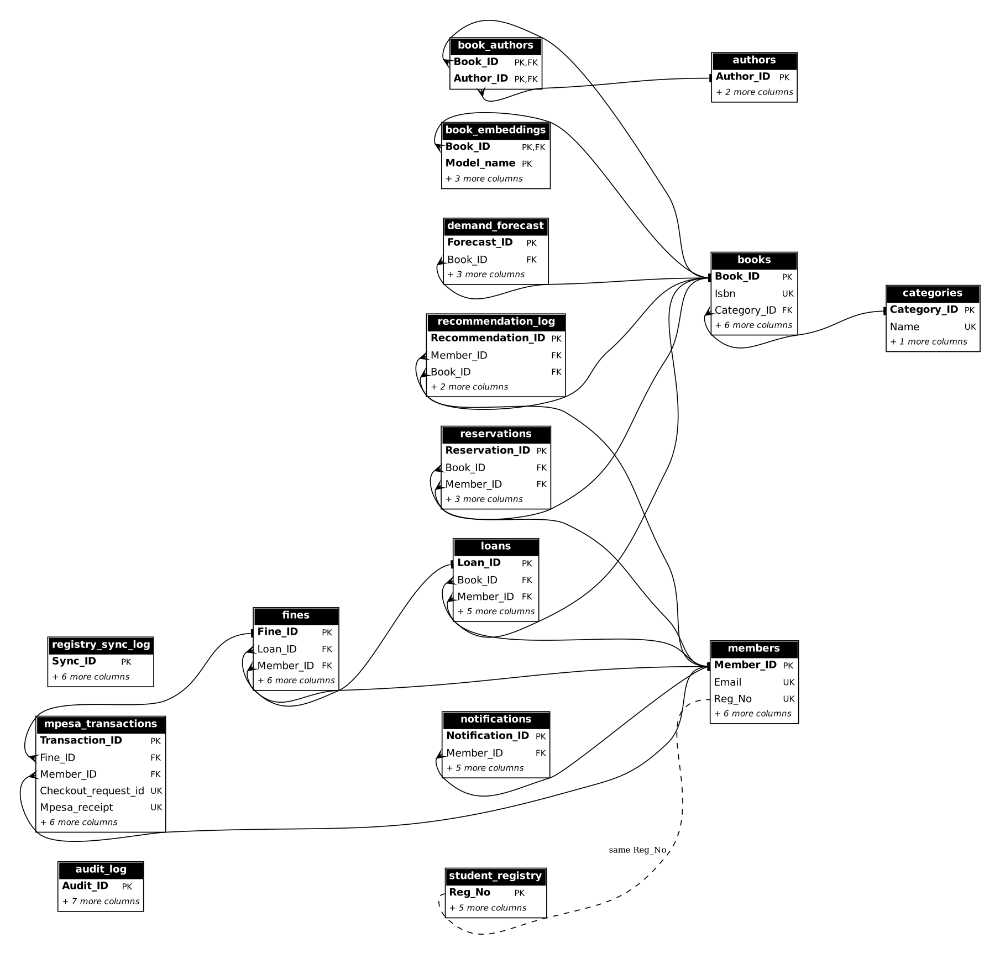
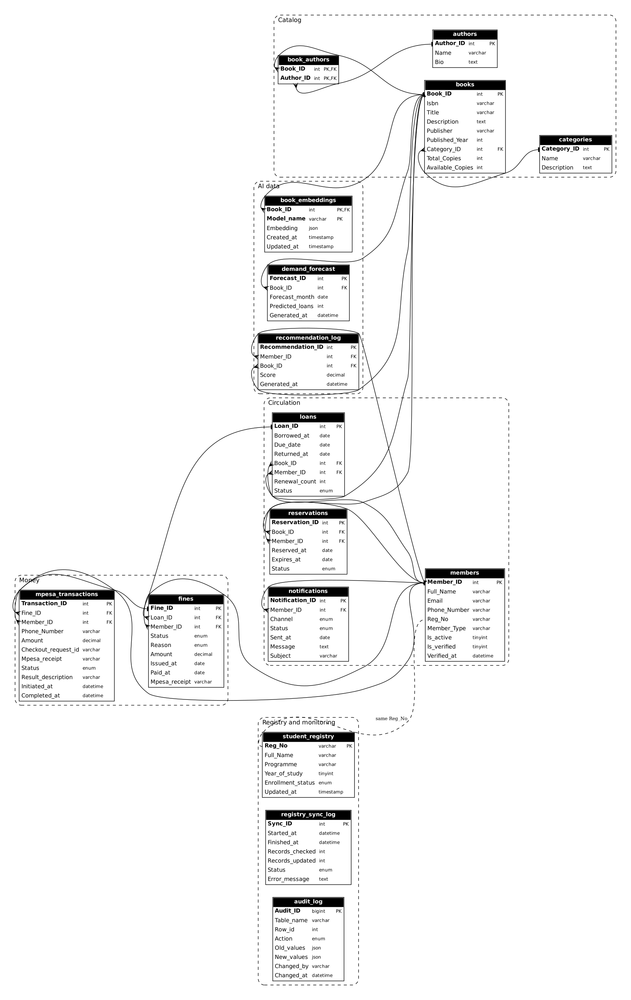
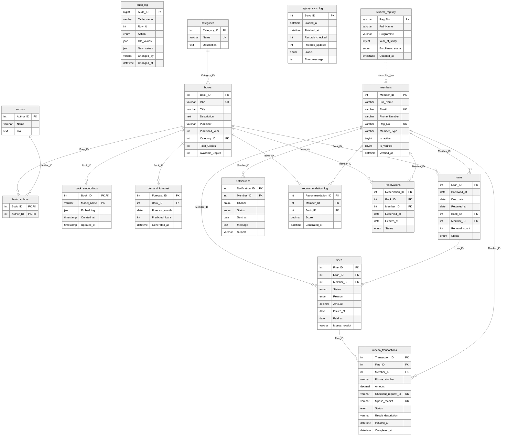

# ER diagram: the KISII_LIBRARY database

An ER (entity-relationship) diagram shows the tables and how they are connected.

**How to read it**

- Each box is a table. The black bar holds its name.
- **PK** marks the primary key (the column that identifies each row). **FK** marks a foreign key: a column that must match a row in another table. **UK** marks a column whose values must be unique.
- A line runs from a foreign key to the key it points to. The end with a small bar is the *one* side. The forked end (crow's foot) is the *many* side. For example, one category has many books.
- A dashed line is a link that is made by matching values, not enforced by the database.

## The main picture (key columns only)

Every column of every table is described in the [data dictionary](data-dictionary.md).

## All columns

## Interactive version

GitHub draws this one itself, straight from the text below.

## Relationships in words

| One row of | can have many rows of | linked by | If the parent row is deleted |
|---|---|---|---|
| `books` | `book_authors` | `book_authors.Book_ID` | deleting the parent also deletes these rows |
| `authors` | `book_authors` | `book_authors.Author_ID` | deleting the parent also deletes these rows |
| `books` | `book_embeddings` | `book_embeddings.Book_ID` | deleting the parent also deletes these rows |
| `categories` | `books` | `books.Category_ID` | the parent can't be deleted while rows point to it |
| `books` | `demand_forecast` | `demand_forecast.Book_ID` | deleting the parent also deletes these rows |
| `members` | `fines` | `fines.Member_ID` | the parent can't be deleted while rows point to it |
| `loans` | `fines` | `fines.Loan_ID` | the parent can't be deleted while rows point to it |
| `books` | `loans` | `loans.Book_ID` | the parent can't be deleted while rows point to it |
| `members` | `loans` | `loans.Member_ID` | the parent can't be deleted while rows point to it |
| `fines` | `mpesa_transactions` | `mpesa_transactions.Fine_ID` | the parent can't be deleted while rows point to it |
| `members` | `mpesa_transactions` | `mpesa_transactions.Member_ID` | the parent can't be deleted while rows point to it |
| `members` | `notifications` | `notifications.Member_ID` | the parent can't be deleted while rows point to it |
| `books` | `recommendation_log` | `recommendation_log.Book_ID` | deleting the parent also deletes these rows |
| `members` | `recommendation_log` | `recommendation_log.Member_ID` | deleting the parent also deletes these rows |
| `books` | `reservations` | `reservations.Book_ID` | the parent can't be deleted while rows point to it |
| `members` | `reservations` | `reservations.Member_ID` | the parent can't be deleted while rows point to it |

## Links that are not enforced by the database

- `student_registry.Reg_No` and `members.Reg_No` hold the same registration number. It is not a foreign key, because a registry student does not have to be a library member.
- `audit_log.Table_name` and `audit_log.Row_id` point at rows in `loans`, `fines`, `mpesa_transactions` and `members` by value.
- `registry_sync_log` stands alone. It is a diary of sync runs.
